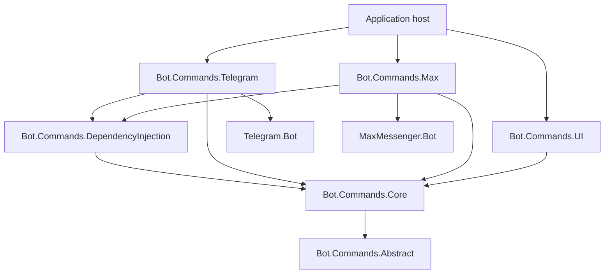

# Architecture and operations

[README](../README.md) · [Commands](commands.md) · [Adapters](adapters.md)

## Dependencies

`Abstract`, `Core`, `UI`, and `DependencyInjection` contain reusable contracts and
behavior without messenger dependencies. Core references only Abstract. Adapter
projects contain SDK-specific contexts, registration, addressing rules, and conversions.
The dependency direction is adapter → shared projects; common DI never references
an adapter. A Max-only consumer does not acquire the Telegram SDK from the common engine.

For manual registration, provide the four application services from
[getting started](getting-started.md#3-register-application-services), then register:

- `SessionManager` and `ISessionManager` resolving the same scoped instance.
- `CommandExecutionService` as scoped.
- An `ICommandFactory` that resolves concrete command types.
- All command implementations as scoped.
- The appropriate scoped `IBotCommandResolver<TUpdate>` implementation.

The public resolver implementations are
`Bot.Commands.Telegram.Services.TelegramCommandService` and
`Bot.Commands.Max.Services.MaxCommandService`. `UseBotCommandsServices()` registers
the common services and discovered commands, but no platform resolver/client.

## Execution flow

1. Your receiver obtains an SDK update and creates a DI scope.
2. The adapter converts a supported update into a typed query context.
3. The common service selects an event handler, active session, or query command.
4. It checks authorization and chat-area restrictions.
5. The command factory resolves the command instance and the engine invokes it.
6. The command returns a result.
7. The service opens, continues, releases, or leaves the session unchanged.

Exceptions interrupt this flow; the engine does not commit an execution result
after an unsuccessful handler. Side effects already performed by the handler are
not rolled back. Event dispatch bypasses ordinary session selection, but the
event handler's returned result still participates in session processing.

Command discovery and routing currently use reflection over loaded assemblies.
Session and behavior calls use reflection where the data type is only known at
runtime. Query commands use their typed interfaces. Reflection discovery is not
cached as a finalized command registry, and trimming/Native AOT deployment has
not been established by this implementation.

## Operational boundaries

### Session isolation

The store contract identifies a session by chat ID and user ID. Use a separate
partition or store instance for each bot/platform, and resolve the correct profile
and clients with it. Different scopes sharing a singleton store and profile still
share the same namespace. Swarms do not isolate session records.

### Ordering and concurrency

The framework does not lock a chat/user session or deduplicate updates. Serialize
updates for the same session, or use a host/storage design that provides equivalent
protection. This matters both for multiple workers and overlapping asynchronous
handlers in one process. A dictionary made thread-safe alone does not make a
read-execute-write conversation transition atomic.

### Persistence and side effects

Choose serialization and data migration rules for your session types. If a handler
sends a message and persistence then fails, replay can send it again. Supply
idempotency where duplicate external actions would matter. The library does not
provide an outbox, distributed transaction, or retry policy.

The clock and store must agree on time conventions; UTC is a practical choice.
Expiry filtering belongs in the store. See the precise continuation behavior in
[the storage contract](commands.md#session-storage-contract).

### Hosting

Polling, webhook registration, request authentication, cancellation, rate limiting,
logging, and SDK acknowledgments are application responsibilities. The resolver's
`Handle(Update)` API does not currently accept a cancellation token.

Unsupported update types are ignored; malformed supported updates may fail while
the context reads required fields. Keep platform update validation at the integration
boundary rather than assuming every deserialized object contains a chat and sender.

## Error handling

| Exception | Typical meaning |
| --- | --- |
| `CommandExtractionException` | Command extraction/selection failed |
| `CommandPermissionException` | Authorization denied |
| `CommandChatAreaException` | Command is unavailable in this chat type |
| `BotDomainException` | Application-level input or workflow error |
| `CommandsInternalException` | Invalid engine/session setup or operation |

The first three expose `ChatId` through `ICommandException`. Shared exception names
are messenger-independent. Other exceptions from your
commands, store, DI container, and SDK can also propagate.

Catch expected exceptions in the host, log useful command/update context, and
decide whether to send a user-facing explanation. Avoid returning raw exception
details to users. Failed authorization does not automatically generate a reply.

## Troubleshooting

| Symptom | Check |
| --- | --- |
| A command is not found | Attribute name, leading slash, compatible SDK query type, loaded assembly, swarm configuration |
| “Too many commands for query” | Both duplicate matches and zero matches can currently produce this message; inspect registered candidates |
| Telegram group command is ignored | Use `/command@bot_name`; include Group/SuperGroup in `Area` |
| A callback handler receives null | Match the handler's native SDK type; do not expect a context in `Next`/`OnCallback` |
| A sender cast fails | Message senders receive contexts, and the state may have been reached from a different query type |
| The second step starts over | Store lifetime, expiry filtering, serialization of the full Fluent wrapper, bot identity |
| `/cancel` is treated as an answer | Ordinary sessions take precedence; use behavior/Fluent interception |
| DI cannot create a command | Register constructor dependencies; ensure the concrete command type was discovered |
| Max callback has no nested message | Pass the top-level update message to the context, or use the resolver |
| A session lasts longer than expected | Continuation adds duration to the existing expiry; null removes expiry |
| `AheadFluent(..., true)` fails | `ExecuteResult.Fire` is not handled; use direct Fluent entry or `fire: false` |

## Verification scope

The automated tests exercise the engine with SDK objects and representative Max
JSON payloads. The offline quick start verifies DI scopes, query commands, session
continuations, and a shared Fluent flow without network calls. Neither verifies a
live bot's webhook configuration, credentials, SDK requests, or platform permissions.
